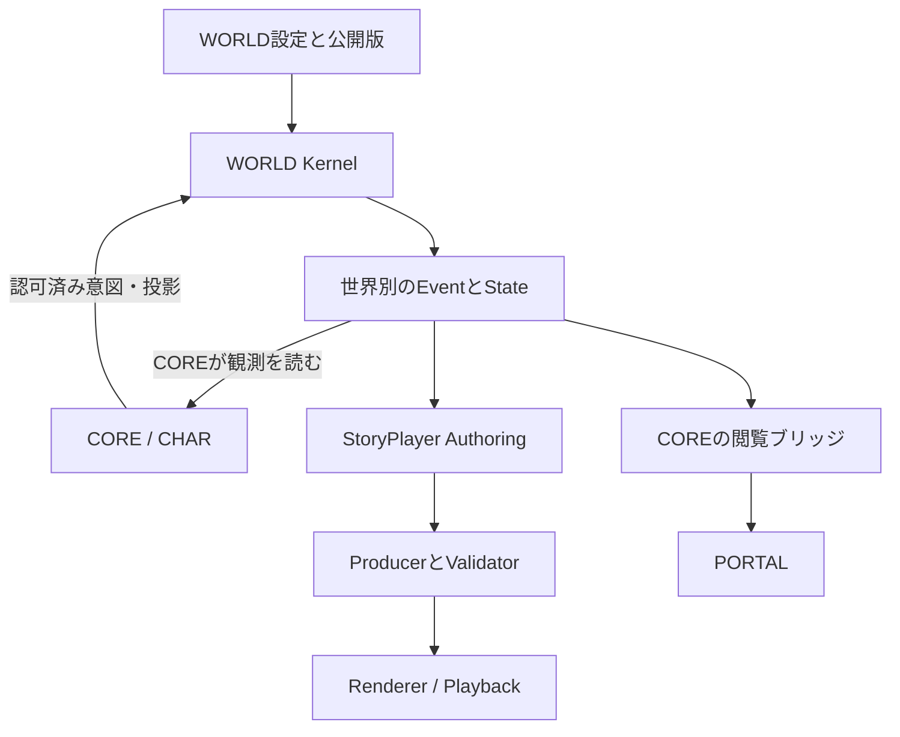

# WORLD 統合仕様 v1.4.0

**統合日：2026年10月20日 JST**  
**対象：共通WORLD基盤、StoryPlayer、「異世界技術者」、RenCrowのエージェント生活世界**  
**位置づけ：既存決定を継承し、実装に必要な契約を補った設計仕様。製品の稼働完了を示す版番号ではない。**

## 1. 実現するもの

WORLDは、人物やエージェントが存在し、時間が進み、行動に結果が生じ、その結果を履歴として残す共通基盤とする。同じKernelを使い、異世界技術者の作品世界とRenCrowの生活世界を別々に稼働できる。StoryPlayerは、その世界を使う作品の構成・原稿・演出・再生を担当する。

共有するのは実装と契約である。世界法則、人物の世界内個体、現在状態、履歴、正史、経験記憶は世界・Timelineごとに管理する。ある世界での行動や作品内の出来事を、別の世界の実体験へ自動的に移さない。

この仕様の実装によって、次の利用が可能になる。

| 利用 | WORLDが担うこと | 外側が担うこと |
|---|---|---|
| 異世界技術者の世界構築 | 採用設定、地理・社会・装置・魔法、公開版、人物の存在と世界内状態 | CHAR/COREの人格、StoryPlayerの作品構成 |
| 小説・ノベルゲーム | 物語用Timelineの事実、行動結果、分岐、人物ごとの観測可能範囲 | 執筆、伏線・開示順序、選択肢、画面・音声 |
| RenCrow HOUSEの常時生活 | 世界時間、位置、日常動作、家具・移動・訪問、確定した世界内出来事 | COREの会話・認知・仕事・記憶、PORTALの描画 |
| エージェントの作品出演・再演 | 上演の場と実際の参加履歴、独立した劇中世界 | StoryPlayerの台本・演出、COREの出演判断・演技生成 |

最後の「再演」は共通基盤への接続方式を今回補完するもので、演技の揺らぎや自動演劇がすでに実装・受入済みという意味ではない。

### 1.1 何を最新として扱ったか

本書の版と、作品の世界設定版、RenCrowの個別製品仕様版を分ける。

| 系列 | 確認した基準 | 本書での扱い |
|---|---|---|
| 異世界技術者の設定 | v1.3.5、2026-10-14追補 | 地理・魔法・文明・交通・農牧・港湾の基底 |
| 後続の季節・航海等 | 2026-10-16「設計と検証_v0.2.md」 | 作者決定と気候実験の入力仮定を分けて追補 |
| WORLD/CHAR/StoryPlayerの所有 | 責務分離v0.4 | WORLD内novel_authoring所有を廃止した境界を継承 |
| RenCrow生活世界 | FINAL v1.0、2026-10-19 | CORE連携、8住人と訪問者、既存R04/R05、R06以降の基準 |
| 共通生活基盤の原型 | LivingWorld v0.1 | Event/State、観測、日記、Timelineの設計資産を再利用 |
| 今回の統合 | 本書v1.4.0 | 多世界、版番号、実行契約、未定値、表示配信、移行の不足を補う |

「最新」は上記で原文を確認できた資料の統合を指す。10月19日のソース実装状況は同日の監査資料の記載であり、この仕様作成ではリポジトリの現在HEADや本番機を再監査していない。

本文で**継承**とする規則は既存の決定・仕様を引き継ぐ。**今回補完**とする規則は、その境界を実装で守るための推奨契約である。世界の未決定の真相や作品内容を新たに採用したものではない。技術上の必須・禁止は、この統合仕様を実装する場合の契約を表す。

## 2. 正本の所有と接続

### 2.1 所有者を一つにする

| 対象 | 正本を持つ領域 | 他領域へ渡すもの |
|---|---|---|
| 世界法則・地理・物体・国家・社会制度 | WORLD | 版と権限を固定した参照 |
| 世界時間・位置・行動・数量・占有・世界内履歴 | WORLD Kernel/Store | Snapshot、Event、観測候補 |
| 人格・価値観・関心・目標・意思決定 | CORE/CHAR | 人格版の参照、行動意図、生活許可の投影 |
| 本人の認識・主観的な関係・経験記憶 | CORE/CHAR | 許可されたContext、採否Receipt |
| 婚姻・所有・所属等の世界内の客観的関係 | WORLD | Fact/Relation。本人の好感や誤解とは別 |
| 実際の仕事、Task/Run、LLM・Tool利用、成果 | COREと既存Harness/LLM等 | 全量WorkSet、結果Receipt、成果参照 |
| 作品の主題・筋・巻・章・原稿・伏線・開示 | StoryPlayer Authoring | 承認済みStoryProject、NarrativeGraph |
| 演出・画像・声・音楽の割当、再生パッケージ | StoryPlayer Producer | 検証済みPresentationPackage |
| 再生位置・選択履歴 | StoryPlayer PlaybackSession | ローカルResume、必要時ChoiceReceipt |
| HOUSEの部屋・家具・経路・利用権限 | WORLDのSpatialBundle | 版付き空間投影 |
| HOUSEの美術・キャラモデル・アニメ・カメラ | PORTAL側VisualAssetBundle | WORLDの位置に対応した表現 |
| 人間向け日程・支援・通知 | 既存ASSISTANT | 必要な世界参照。エージェント生活とは別 |

WORLDに人格の第二正本を作らない。COREに位置の第二正本を作らない。StoryPlayerに世界事実の第二正本を作らない。読み取りキャッシュや投影は許可するが、正本の版・出所を保持し、正本と独立して変更しない。[S1][S3]

### 2.2 論理的な構成

図の「COREが観測を読む」はCORE起点のRead/Streamである。WORLDからCOREへのHTTP callbackや、Kernelの状態遷移中のLLM呼出しを作らない。StoryPlayerが世界を動かす場合も、Authoring Controllerが正規のCommandを送る。Rendererは世界を直接変更しない。

WORLD StudioとStoryPlayer Editorを同じ画面に置くことはできる。ただし保存先のOwnerは分離する。HOUSEは独立したサービスではなく、WORLDの空間コンテンツとPORTALの美術コンテンツを合わせた製品機能とする。

## 3. 世界、履歴、人物、作品の識別

### 3.1 共通Kernelと独立したWorldInstance

**今回補完：**共通Kernelには、RenCrowの8人、異世界の重力、特定の魔法、特定の家の階数を埋め込まない。これらはWorldDefinition/Profileの設定とする。

| 単位 | 例 | 独立させる内容 |
|---|---|---|
| WorldInstance | `rencrow-home` | 生活用法則、住人、空間、Store、権限 |
| WorldInstance | `isekai-engineer`（実装用仮ID） | 異世界設定、登場人物、町・装置、Store、権限 |
| Timeline | `home-live` | 常時生活の履歴 |
| Timeline | `novel-main-draft` | 異世界技術者の執筆用分岐 |
| Timeline | `novel-test-001` | 試験用ルール・仮値を使う独立分岐 |
| StoryProject | `isekai-engineer-series`（仮ID） | 作品構成、原稿、開示・演出 |

仮IDは機械的な識別子であり、作品の正式題名・世界名・町名の決定ではない。旧サンプル`rencrow_home`、開発用`r04-house`、本番向け`rencrow-home`を文字列正規化だけで同一世界にしない。

初期実装は同じGoバイナリを世界ごとに別プロセス・別DBで起動する構成を推奨する。共通プロセスで複数世界を扱う場合も、Writer、キュー、権限、参照解決、DB、資源上限を分ける。単一の共通DBへ全世界の正史を混ぜる設計を初期構成にしない。

### 3.2 人格と世界内個体

`char_identity_id`はCORE/CHARの人格識別子、`persona_revision`は人格版、`entity_id`は世界の存在、`actor_instance_id`はそのTimelineで行動する個体を識別する。`cast_role_id`はStoryPlayerの配役である。

同じ人格の定義を複数の作品に利用できるが、記憶は`world_id + timeline_id + actor_instance_id`に束縛する。別Timelineで得た経験を同じ人格IDだからという理由で結合しない。記憶の共有が必要な場合はCOREが明示された共有方針で行い、由来と役柄を保つ。

RenCrowの住人IDをCOREへ新設する操作と、作品内NPCのEntityをWORLDへ作る操作は別権限とする。LLMが任意のAgentIDを発行して既存人格を上書きできる構成にしない。

### 3.3 正史は用途ごとに定義する

Timelineは`live / fiction / simulation / rehearsal / performance`等の用途を持つ。**用途と正史の採否は別に管理**する。

- `canon_scope`：生活世界・作品・上演等、どの対象の正史か。
- `canon_status`：`draft / candidate / approved / retired`。提案と採用履歴から得る状態とし、可変Timeline全体への一括承認にしない。
- `memory_writeback_policy`：別世界・本人のLive記憶へ移せる範囲。既定は自動還流禁止。

異世界技術者の本編を作品内の`approved`正史としながら、RenCrowのLive経験への還流を禁止できる。旧`canon=false`を「作品にも確定事実が存在しない」と読み替えない。

作品の正史承認は`CanonReleaseRecord`に、採用対象のWorldBundle版、Timelineとepoch、Snapshot、Event終端、原稿Revision、採用者、採用方針版を固定する。採用記録自体は不変とし、撤回・置換は別の履歴記録で表す。承認後に同じTimelineへ追加したEventは、その承認に含めない。生活世界は認可済みKernel Eventを運用履歴へ逐次採用する方針を持てるため、日常動作のたびに作者承認を求めない。

分岐は親TimelineのSnapshotとEvent cursorを固定し、そこから独立して進める。Actorごとの認知起点も、分岐点までに本人が取得済みの情報を含むCORE所有の`ContextSnapshot`で固定する。WORLDにはそのID・cursor・policy版・hashを参照として保持し、記憶本文を移さない。親の現在Contextを古い分岐へ流用しない。再構成できない場合は、その不足を示して認知の開始を保留するか、明示された初期知識Profileを採用する。

子の会話Session・推論Context・経験記憶は子scopeに分離する。固定された親Snapshotや許可済み知識への読み取り参照を認めても、分岐後の変更を親へ自動mergeしない。正史への採用は内容・前提・依存を確認した明示操作とし、必要なら対象世界内の新しい改訂として作る。

## 4. 世界設定と実行規則を分ける

### 4.1 四つの判定軸

既存レジストリの一つの`status`へ意味を詰め込まず、以下を分けて管理する。

| 軸 | 値の例 | 問い |
|---|---|---|
| 作者の採否 | adopted / direction / proposed / undecided / rejected / superseded | 作者が何を採用したか |
| 主張の種類 | world_fact / belief / hypothesis / observation / unset | 世界の事実か、誰かの説明か |
| 公開・知識の範囲 | author_only / actor_scoped / public、知識根拠参照 | 誰がこの内容を知れるか |
| 実装への反映 | draft / schema_validated / publishable / published | 実行系に反映されたか |

「誰も知らない確定済みの秘密」と「作者も未決定の内容」を区別する。未決定を秘密設定として補完しない。確定した世界事実も、CHARの知識や読者の既知へ自動で移さない。

既存165件は履歴を含む設定レコード数であり、165個の実装可能な独立法則ではない。包括的な旧未決文、部分解決済み候補、後続決定が同居するため、`fact_key + scope + supersedes + source_ref`で現行値を解決する。文書全体の「後勝ち」や「確定だけ抽出」では再構成しない。[S2]

### 4.2 LoreRevisionとExecutionProfile

**今回補完：**一つの実行版を次の三つから構成する。

1. **LoreRevision**：作者が定めた世界設定と採否履歴。
2. **ExecutionProfile**：時間単位、行動の所要時間、数値上限、Rule handler、空間データ、未定値への対処。
3. **PublishedWorldBundle**：両者と依存素材・型の参照を固定し、実行可能な範囲を検証した不変の束。

ExecutionProfileの値には`basis=author_adopted / implementation_assumption / measured / derived`、根拠、適用範囲を持たせる。仮値は`assumption_ref`でEventへ追跡できるようにする。試験用Profileを使った結果を作者正史へ自動昇格しない。

`derived`や実験内の`measured`も、依存した仮定を推移的に保持する。算術検証や測定が成立しただけで、作者の採否・正史適用範囲を変更しない。仮置き半径から計算した惑星質量も、元の半径が仮定ならその依存を残す。

Publishは不変Bundleを作成する操作であり、稼働中Timelineの参照版を自動更新しない。既存Timelineへの適用は別の`adopt_world_bundle`操作とし、旧版・新版、対象State終端、移行Rule版、活動・予約の継続／中断／移行を検証し、適用結果Eventを確定する。安全に移行できない場合は新版を使う別Timelineを作る。既存SceneやSnapshotの参照版も書き換えない。

値が未定の場合は、必要な操作だけ`needs_parameter`にする。町の移動時間が未定でも、既存事実の閲覧や他の確定済み行動を止めない。作者判断が必要な操作を勝手な推測で成功させない。

### 4.3 魔法を実行可能にする最小境界

魔法の根本原理が未定でも、外部から観測する対象・入力・効果・使用可能範囲を定めた抽象Ruleは実装できる。ただし、実用性能の数値すら未定なら、正史としてその数値を要求する操作は実行しない。

例えば水魔法は「容器へ生活水を得る」という採用済み現象をもとに、試験世界でのみ容器容量や待ち時間を指定できる。その値は試運転用であり、魔法の原料や供給機構を決めたことにはならない。`mana=100`のような共有MPを既定の世界法則として追加しない。

本番の物語進行で具体的な量・距離・連続運転が争点になった場合は、その条件を作者設定として採用するか、限定された操作モデルとして承認する必要がある。既知の現象の再現と、世界の真相の発見を同じ処理にしない。

### 4.4 運用開始に必要な範囲だけ公開する

WorldBundleは世界全域が精密に完成していなくてもよい。`capabilities`に公開済みの行動と領域を宣言する。未定の地理や魔法は説明・検討用として保持し、実行可能なRoute/Actionから除外する。

農業・経済・気候等の重い計算は、必要な時空間粒度の別モデルで扱う。結果を取り込む際は入力版・モデル版・計算範囲・仮定・検証結果を参照する。背景地域を一律に個人単位・秒単位で計算することを共通Kernelの完成条件にしない。

## 5. 共通データ契約

### 5.1 必須データ

| データ | 主な内容 |
|---|---|
| WorldDefinition | WorldID、型・法則・場所・存在・物体・権限、拡張ドメイン |
| SettingRecord | fact_key、値、採否、出所、適用範囲、置換履歴 |
| ExecutionProfile | Rule版、計時・数値・仮定、初期条件、公開Capability |
| WorldSpecRevision | 検証済み定義の不変版とhash |
| Timeline | 用途、親Snapshotと認知起点、採用方針、時間方式、記憶還流方針 |
| WorldState | 最新確定状態。Eventの再生で復元できる投影 |
| WorldEvent | 確定した出来事、原因、時刻、変更、根拠、可視性 |
| Command/Receipt | 行動要求、認可主体、採否、冪等キー、結果Event |
| ActivityInstance | 長時間活動、段階、予約、期限、中断・完了状態 |
| Observation | 対象Event、観測者、知覚経路、時点、渡した内容、受理 |
| WorldSnapshot | Spec版、Timeline、cursor、状態hash、再生起点 |
| Proposal/ReleaseRecord | 変更提案、比較、採否、公開した版 |
| CanonReleaseRecord | 作品の承認対象Bundle・Timeline・Snapshot・Event終端・原稿版 |

Organization、Species、Language、Culture、Economy、Magic等は名前付きドメイン拡張とする。国家や交易をすべてEntityの自由文に押し込めない。所有・所属・接続等は型付きRelationで結ぶ。

### 5.2 版番号を混同しない

**今回補完：**新規契約で`world_revision`を単独使用しない。

| 名前 | 意味 |
|---|---|
| `contract_version` | 通信・構造の版。未知majorは拒否 |
| `world_spec_revision` | 世界定義と実行Profileを固定した不変版 |
| `timeline_epoch` | 同じTimelineの履歴世代。通常再起動では変えない |
| `event_seq` | Timeline内で確定したEventの連番 |
| `state_seq` | Stateへ反映済みの最後のevent_seq |
| `source_epoch` | CORE等の投影発行元の世代 |
| `source_revision` | 同じ発行元・Actor・投影種別・世代内の連番 |
| `view_cursor` | 閲覧権限で投影した配信列の不透明な位置 |

旧LivingWorldの`world_revision_id`は定義版へ、RenCrow個別案の実行連番`world_revision`は`state_seq/event_seq`へ対応させる。COREのsource_revisionとWORLDのevent_seqを大小比較しない。

公開JSONの連番は0から2^53−1までの整数に制限する。Goのuint64を上限確認せずJavaScript Numberへ渡さない。上限を超える形式が必要なら通信major版で変更する。

`timeline_epoch`と`source_epoch`は順序比較しない不透明な識別子文字列とする。CommandとCORE投影Envelopeは宛先`timeline_epoch`を必須にし、別の履歴世代への要求を拒否する。

### 5.3 時刻は三種類を持つ

- `recorded_at`：WORLDが確定記録した実時間UTC。
- `occurred_at`：外部の実行結果等が実際に確定した時刻。出所を保持する。
- `world_time`：そのTimeline内の時刻。単位・暦はClockProfileに束縛する。

新規の世界内行動はWORLDがworld_timeを決める。クライアントが過去・未来時刻を申告しただけで世界事実にしない。外部の遅延報告は発生時刻と受信・記録時刻を別に残す。

作品暦が未定なら相対時間を使える。UTCを異世界の正式暦へ勝手に変換しない。CORE投影の`valid_until`は実時間による期限であり、加速されたfiction時計では評価しない。

State hashの対象は、確定済みのClock anchor・倍率・最終確定時刻、投影の`valid_until`等の保存値とする。読み取り時に外挿した「今の世界時刻」や「今のfreshness」は派生表示値へ分ける。期限切れが活動・予約を変える場合は、その変更を期限切れEventとして確定する。Replay中に現在の実時計で新たな遷移を発生させず、Live復帰後に期限を整合させる。

## 6. WORLD Kernelの実行契約

### 6.1 Commandから確定結果まで

Kernelは次の順序で処理する。

1. 認証した主体からWorld/Timeline/Actorの権限を確定する。
2. 既知の契約版、引数型、サイズ上限、参照scope、宛先timeline_epochを検査する。
3. 冪等キーに既存Receiptがあれば内容digestを照合し、同じ結果を返す。
4. 世界定義版、対象状態、期限、行動前提、資源・経路・占有を検査する。
5. 登録済みRule handlerで効果・必要時間・乱数結果を決定する。
6. 変更後の不変条件を検査する。
7. Event群、State投影、Activity/予約、Receiptを一つのDB transactionで確定する。
8. 確定後にRead/Streamへ公開する。
9. COREやStoryPlayerが結果を読み、次の判断・文章・演出へ進む。

一要求が複数Eventを作る場合は、同じ`transaction_id`と順序を持たせ、event_seqを連続採番する。途中までのEventだけをSnapshotや配信へ出さない。クライアントはtransaction単位のDeltaを適用する。

Event一覧もtransactionを分割しない。初期上限は一transactionあたり128 Event・シリアライズ後256 KiBとし、一回の一覧は500 Event・2 MiB以内で完全なtransactionを返す。残り容量に収まらない次transactionは次ページへ回す。単体上限超過はCommit前に拒否するか、部分完了と中断を表せるActivityへ明示的に分割する。原子的であるべき資源取得を裏側だけで分割しない。

Kernelの遷移関数はClock、決定論的乱数、検証済み入力を注入し、LLM、HTTP、外部Tool、描画、実機作業を同期呼び出ししない。再生は保存済みEventの適用であり、LLMやRuleの再抽選ではない。

### 6.2 状態競合と冪等性

Commandのキーは`world_id + timeline_id + timeline_epoch + authenticated_client_id + idempotency_key`とする。epoch照合はReceiptの再取得より前に行う。同じキーと同じpayloadは同じReceiptを返す。同じキーで違うpayloadは`409 idempotency_conflict`とする。新規契約のdigestはRFC 8785 JCSによるUTF-8表現のSHA-256とし、Command本文の全フィールドを対象にする。認証tokenや再送時の通信headerは本文へ混ぜない。JSONの重複キー、非有限数、不正なUnicodeを入口で拒否し、正規化規則を各言語で独自に変えない。[E5]

turn_basedの手番や作者編集は`expected_state_seq`による厳格な状態照合を用い、競合時は`409 state_conflict`とする。real_timeのActivityIntentはActor・対象・依存資源の版と、登録済みRuleが要求する前提を現在Stateで再検証する。無関係なActorやWorkSetだけが更新された場合は、同じ構造化Intentを再検証してCommitできる。クライアントの依存集合だけを信用せず、サーバーがRuleの必須依存・資源制約を検査する。

意味に関わる前提が変わった場合は`409 dependency_conflict`等で拒否し、許可済みの観測から再判断する。目的が同じという理由で別の対象・費用・結果へすり替えない。無関係な全体連番の更新だけで、LLMへの再質問を必須にしない。

COREの全量投影は別方式で、認証済み発行元と宛先World/Timeline/epochの内側で`actor_id + projection_kind + source_epoch + source_revision`を照合する。同版同digestは冪等、同版異digestは競合、古い版は拒否。期限を延ばす場合もsource_revisionを進める。

ネットワーク配送は重複を前提とする。ここで保証するのは同一WORLD内の効果とReceiptの冪等性であり、COREや外部Toolまでまたぐ分散transactionではない。実仕事の再実行をWORLDの再送に結び付けない。

### 6.3 失敗と世界内の試み

JSON構文不正、重複キー、未認証、宛先scopeや冪等キーを確定できない入口拒否は、HTTPエラーと入口監査ログに残し、共通Receiptにしない。認証・構造・scopeを確定したCommandについて、未知参照、権限不足、前提不成立等をReceiptの`rejected`として残し、Stateを変えない。単なる通信エラーと区別する。入口監査にraw bodyのhashを残す場合も、CommandのJCS digestとは別種として記録する。

一方、鍵のかかった扉を実際に開けようとして失敗する等、世界内の試み自体に時間・音・疲労が生じる場合は、許可されたActionの結果として`attempt_failed`等のEventを作れる。処理受付拒否と、世界内で行動して失敗した結果を同じものにしない。

秘密対象の存在を拒否理由から漏らさない。Actor向けエラーは観測可能範囲に制限し、詳細な監査理由は作者・運用者権限へ分ける。

### 6.4 Ruleの実装形式

初期Ruleは`handler_id + handler_version + typed_parameters`を用いるGoの登録済み実装とする。JSON/YAMLに書かれた任意Python、JavaScript、Shellや自然文をそのまま評価しない。自然文の世界設定はCompiler入力であり、実行コードではない。

未知handler、型不一致、依存不足、未定の必須値を公開時に検出する。LLMがRule案を作ることはできるが、Schema・意味検証・作者設定との整合を通った版だけを公開する。

## 7. 活動、時間進行、停止復旧

### 7.1 長時間活動

ActivityInstanceは`planned / running / waiting / completed / interrupted / failed / cancelled`の状態を持ち、開始条件、所要時間、段階、占有資源、中断・再開条件を記録する。一Actorのprimaryな生活活動は最大一つとする。実仕事の投影は別状態であり、生活活動の完了からTask成功を推論しない。

WorkPresenceは身体を動かす第二のControllerにしない。新しい仕事の在席要件、通行安全、訪問期限等を同じ生活Controllerの制約として解決し、一つのActivityから移動・着席を進める。COREの実仕事は、この移動や着席の完了を待たず進められる。

移動、着席、工作、休息等は開始・中断・到着・完了などの意味Eventを記録する。毎フレームの位置やアニメ状態をDBへ書かない。表示は確定経路と時刻から補間する。

### 7.2 時計の方式

| Profile | 進め方 | 用途 |
|---|---|---|
| real_time | 実時間と世界時間を対応させる | HOUSE常時生活 |
| turn_based | 正式に受けた行動や明示advanceで進む | 対話型ノベル、試験 |
| event_driven | 次の予定Eventまで進む | 長期間の生活・物流試算 |
| paused | 明示操作まで停止 | 編集・比較・再開待ち |

画面の開閉、再生速度、フレームレートで世界時計を変えない。早送りは閲覧だけなら世界状態に影響せず、simulationのadvanceなら明示的な世界操作になる。

### 7.3 常時生活と認知処理

WORLDは保存されたLifePolicyの範囲で、歩行・着席・休息・睡眠姿勢等を選べる。認知活動、会話、創作、仕事、記憶整理はCOREが既存の資源管理と仕事管理で行う。

「読書姿勢」「本文を読んで分析した」「感想を発話した」「ブラウザで音声を流した」を別記録にする。同室や視認可能という条件は会話の機会であり、会話をした事実ではない。

### 7.4 障害時の規則

| 状態 | 必須の扱い |
|---|---|
| PORTAL停止 | WORLDとCOREの既存活動は継続。再接続でSnapshotを取得 |
| CORE停止 | 許可済み非認知動作のみ。新しい発話・調査・知的成果を生成しない |
| LifePolicy期限切れ | 明示された保守的idle/rest等だけ。人格や許可を推測しない |
| WorkSet期限切れ | 仕事状態unknown/stale。仕事完了や自由生活への復帰を確定しない |
| WORLD停止 | COREの仕事は継続可能。世界内演出は不明として扱う |
| 素材・音声不足 | 世界を変更せず、指定された表示fallbackまたは素材エラー |
| 長時間停止から復旧 | 保存状態を再生後、一度だけ限定catch-up。未実行会話・調査を捏造しない |

WorkSetがstaleの間は、作業成功を意味する演出を止め、現在地で許可済みの保守的動作を許す。移動中なら予約・通行安全を保って停止または安全なAnchorへ移る。freshな全量投影が戻るまで、仕事解除や新しい認知処理をWORLDが決めない。

復旧のcatch-upはProfileに上限と結果計算規則を持たせる。省略した区間は`recovery_gap`として記録する。停止中に実際には動いていなかった世界を「24時間ずっと生活した」と報告しない。

## 8. 空間、占有、地理

### 8.1 空間の三つの完成段階

- `logical_ready`：場所ID、接続、入室権限、設備が整合する。
- `spatial_ready`：単位・軸・座標・移動経路・衝突・Anchorを実素材に照合した。
- `visual_accepted`：参照美術と必要な視点・端末で完成表現を受け入れた。

座標不明を`(0,0,0)`に変換しない。論理的な部屋状態で先に試験することはできるが、実歩行・座席接触や美術まで完成したとはしない。[S3]

### 8.2 予約と衝突

家具、座席、道具、在庫、狭い通路はRuleで資源として扱う。必要な資源はtransaction内で全件予約するか、全件失敗する。二人が最後の一杯を取得する、同じ一人用椅子へ同時に座る等を許さない。

予約はowner Actor、対象、利用区間、期限、Activity IDを持つ。キャンセル、失敗、退室、訪問終了、復旧では予約を解放・再検査する。新SpatialRevisionの公開だけでは稼働中空間を変更しない。Timelineへの版適用時に、古い移動計画・予約の継続可否と再計画を検証する。

身体の存在位置はWORLDが一つだけ持つ。Main、PinP、LCP、仕事場、正面図、45度視点は同じ位置の投影である。カメラ切替で移動EventやTaskを起動しない。

### 8.3 大地図とローカル実行図

場所の接続グラフ、緯経度・距離のある地図、表示用イラストを別データとする。画像に描かれた名前・国境・縮尺からWORLD事実を自動生成しない。

異世界のR01〜R13は既存の接続案・可能性のまま保持する。Routeの公開には対象区間、手段、必要時間、季節条件、容量、利用可否の定義が必要である。資源適地の存在から輸出余剰や開通済み物流を生成しない。

初期稼働は町・家・工房の小さな範囲に限定できる。全大陸の道路や人口が未定だからといってKernelや第一の生活範囲の実装を止めない。

## 9. 観測、知識、日記と報告

### 9.1 全体の事実と本人の認識

WORLDの全体Stateを全ActorのContextへ入れない。Observationは少なくとも対象Actor、対象Event、world/timeline、知覚時点・経路、可視条件、渡すFact、根拠を持つ。

観測可能、Contextとして配達済み、COREが本人の経験として受理済み、長期記憶へ保存済みは別状態とする。WORLDは候補を作り、COREが既存Memory手順で採否を決める。WORLDからCOREのMemory DBへ直接書かない。

Author用の全知閲覧、Viewerの閲覧、世界内Actorの知識を別の権限にする。作品内の秘密を作者が読めても、登場人物が知っているとは扱わない。

**移行上の注意：**旧WorldSpecの`public_background`は作者用草案を含む。主人公の地球・日本出身等を、キー名だけで全Actorへ公開してはいけない。Fact単位の可視範囲と初期既知を定義して取り込む。[S2]

### 9.2 信念・誤認・仮説

CORE/CHARは主張ごとに内容、根拠となるObservationや伝聞、確信、反証、時点を保持できる。信念が世界事実と一致することを要求しない。

魔法を使った後に休むとまた使える観測と、「蓄えた魔力が回復した」という説明を分ける。恩人の「腕が衰えた」という解釈と、楽器の実際の状態も分ける。StoryPlayerはそれを使い、読者に何をどの順序で知らせるかを管理する。

### 9.3 ReportとDiary

Reportの事実記述は、WORLDのEventか、COREの確定した仕事・会話等の根拠を必須とする。Diaryは`fact / perception / feeling / interpretation / wish`を区別し、未観測の他者の出来事を本人の経験として渡さない。[S4]

本人による日記生成ができないときは`blocked`とする。別Agentが本人の体験・感情を捏造して完成扱いにしない。事実だけの機械的な活動一覧は、本人の日記と別種の成果物として出せる。

生成ジョブは世界・Timeline・本人・対象期間・Context版・生成方針版で冪等化する。公開済み日記を再生時に書き直さない。修正版は別Revisionとして残す。メール送信等はWORLDの自動作用にせず、既存の認可された通知・送信処理へ接続する。

## 10. COREとの契約

### 10.1 LifePolicy

COREは既存Persona/AgentProfile/Autonomyから、許可する非認知活動ID、適用状態、期限、persona_revisionを投影する。人格文、長期Memory、モデル名、GPU割当をWORLDへ複写しない。

WORLDが許可済みの生活動作を選ぶことと、COREが主体として新しい目的・発話・仕事を選ぶことを分ける。好みの持続的変化はCOREが受理し、新版の投影を発行する。

### 10.2 WorkSet v2の継承

同梱の`inputs/rencrow_final_20261019/contracts/work-set-v2.schema.json`を既存契約として再利用する。新しい共通EnvelopeはWorld/Timeline/timeline_epoch/認証scopeを補い、このpayloadの意味を黙って変えない。

| WorkSetの内容 | WORLDの扱い |
|---|---|
| Run無しqueued | 合法。実作業中にはしない |
| runningかつrun_idあり、house presenceが必要 | 仕事場への移動・作業姿勢を開始可能 |
| waiting/blocked | 待機を表す。進捗を生成しない |
| 複数running | 一件の終了で全仕事解除しない |
| freshで空の全量Set | 現在の対象仕事なし。成功した証拠ではない |
| staleなSet | 仕事状態不明。終了や自由行動への復帰を推測しない |
| 通常Chat | 原則仕事集合に入れず、強制的な仕事場移動を起こさない |

CORE Task更新とOutboxの生成を既存の永続化境界で整合させる。再接続時は最新の全量Setを先に適用し、取りこぼした差分から空集合を合成しない。世代変更は認証済みreconcileで承認し、順序を巻き戻す任意epoch変更を拒否する。バックアップ復元で宛先timeline_epochが変わった場合は、そのepochへのreconcile完了まで投影を保留し、旧世代の送信待ちpayloadを新世代として貼り直さない。

### 10.3 発話と実仕事の根拠

COREは確定したUtterance ID、Session、本文参照、許可された聞き手、発生時刻、世界内位置の根拠cursorをWORLDへ渡す。WORLDに本文の第二正本を作らない。

遅延した発話連携で、受信時の現在位置を発話時の位置として保存しない。指定時点の履歴から確認できるならその位置を使い、確認できなければ`location_unverified`とする。隣室にいた人物を受信時に同室だからという理由で過去の聞き手へ追加しない。

実仕事の完了はCORE/Harnessの結果Receiptを参照する。WorkSetから消えたことは成功・失敗・取消のどれかを判別しない。WORLDが受けた結果Receiptの参照と、世界内の作業姿勢の終了を別Eventにできる。

### 10.4 外部接続の方向

CORE→WORLDは認証済みWrite。CORE←WORLDはCORE起点のRead/Stream。WORLDは外部CORE Clientを持たず、COREの可用性をKernelのready条件に含めない。

他の意思決定器やStoryPlayer Controllerも同じ共通Command契約を使用できるが、`rencrow-home`のCORE専用操作を引き継げるわけではない。Worldごとにprincipalとcapabilityを設定する。

## 11. StoryPlayerとの接続

### 11.1 三層のStoryPlayer

**継承：**StoryPlayer全体を表出専用とする旧v0.1定義は、v0.4で物語基盤へ拡張された。以下を分ける。[S1]

1. **Authoring/Narrative Manager**：主題、巻・章・Scene・Beat・原稿、伏線、視点、知識と開示の計画、作者承認。
2. **Producer/Validator**：承認済み内容、参照World版、素材からPresentationPackageを組む。
3. **Renderer/Playback**：検証済みData Packageを再生し、ローカルSessionを持つ。

文章生成・書き直しはAuthoringの仕事としてCORE等へ依頼できる。Producerが不足原稿を勝手に埋めず、Rendererが文面を補作しない。

### 11.2 世界と物語を結ぶ参照

StoryProjectとPackageは複数の`WorldSourceBinding`を持てる。各bindingはWorldSpecRevision、World/Timeline/epoch、Snapshot、Event範囲を固定し、Sceneまたは分岐区間がbinding IDを参照する。CHAR版と配役も固定する。相互排他的な静的分岐は、別のfiction Timelineまたは整合する固定範囲へ束縛し、読取専用で再生する。世界事実と異なる下書きを試す場合は物語用Proposalまたは別Timelineで扱う。

タイトル・クレジット等の演出のみのSceneは世界参照なしと明示できる。そのSceneで新しい世界事実を述べる場合はbindingを必要とする。作品正史への採用は§3.3の不変なCanonReleaseRecordへ結び付け、Package構造合格と作者の採用を同一視しない。

ストーリーの都合で必要な事件は、Authoring ControllerがWORLDへ通常Actionや作者用の明示的な世界変更提案を送る。作者が出来事を構成する場合でも、権限・型・整合性・由来の記録を通す。任意のstate deltaを通常Actorへ許可しない。

`authored_transition`は作者専用で、草案Timelineに限り、根拠となる採用シナリオと変更理由を残す。既存の正史履歴を書換える操作にせず、新規分岐や訂正Eventとして扱う。通常Ruleによるシミュレーション結果と作者の指定をprovenanceで区別する。

### 11.3 二種類の選択肢

| 種類 | 作用 |
|---|---|
| 静的Choice | 同じPackageのSceneを選ぶ。WORLDを変更しない |
| 動的Choice | ChoiceReceiptをControllerへ渡し、別途認可されたWORLD Commandの結果を待つ |

動的選択に対して画面だけで「成功」を確定しない。Controllerが意図を解釈し、Kernelが結果を記録し、その結果から新しい表出を作る。オフラインPlayerは世界通信を持たず、ブラウザ用Live Controllerが通信を担当する構成にできる。

### 11.4 Packageの必須検査

- PackageはJSONと許可された素材。任意スクリプト・実行ファイルを含めない。
- 相対パス、拡張子、MIME、checksum、参照、容量・展開上限を検査する。
- `../`、絶対パス、Symlink、外部URIをPackage入力として拒否する。
- 必須素材が欠けたらReleaseを止める。任意音声の字幕化等は事前定義されたfallbackだけ許す。
- 世界やCHARへのwritebackはRendererでdeny。
- ResumeはPackage IDと版を固定する。PlayerのSaveをWorldSnapshotとして扱わない。

既存の189入力項目の対応表は継承し、WORLD所有へ戻さない。Draft用SchemaとRelease用Schemaを分け、Schemaでは検査できない参照、Grounding、権限、パス安全性を意味Validatorで検査する。詳細は付録02。

### 11.5 エージェントが演じる作品と再演

**今回補完：**出演者の人格、役柄、劇中個体、上演Sessionを別に識別する。同じ台本で上演するたびに`performance_id`を変え、演技方針版と確定した表出を記録する。

「Mioが上演に参加した」は生活側の実際の仕事・行動として記録できる。「役が異世界で負傷した」は劇中Timelineの事実であり、Mio本人の身体やLive記憶を変更しない。役の経験を振り返る場合も、作品参照としてCOREが扱う。

初期は台本と演出範囲を固定して再生できる形から始める。揺らぎは後続の演技Profileで、間、視線、強弱、許可された言い回し等へ段階導入する。世界法則、事件結果、相手の発話内容を勝手に変える許可と兼用しない。

## 12. 異世界技術者Profileの現行内容

詳細と採否は付録01にまとめる。実装の基底として保持する要点は次のとおり。[S2][S5]

| 領域 | 現行の採用内容 |
|---|---|
| 作品コア | 面白い物語を追ううちに技術の奥深さへ引き込む。第1話で主人公を好きになってもらう |
| 主人公 | 地球・日本出身の技術者。転移から数か月〜数年、小さな町の便利屋。観察・切り分けと好奇心が核 |
| 自然 | 地球準拠の通常物理、重力8.0m/s²、大気は概ね地球同様、陸3：海7の超大陸 |
| 転移 | 肉体を伴う転移、複数世界から来訪。チェンジリングの存在割合は概ね1万人に1人 |
| 魔法 | 火・水・風・木・土。一般人も五系統に素養があり個人差がある |
| 風 | 指定空間の空気を動かす。自然風と併用 |
| 土 | 一般の土砂等から専門家の素材操作へ。エンチャントは土魔導、詳細保留 |
| 日常 | 生活水は魔法、調理は燃料と魔法着火、農業補助は非選択的で世話が必要 |
| 都市・農村 | 都市は第一次産業革命期相当、農村は中世寄り。魔法は農村にも普遍的 |
| 動力・交通 | 水車・風車、人の近距離移動は風、陸上重荷は家畜、大量貨物は船 |
| 機関 | 蒸気機関は一部で限定試験、内燃機関の概念なし、帆船に機械式推進装置なし |
| 砂漠都市 | 魔法そのもののブレイクスルーが実用化され都市を支える。機構・量は未定 |
| 道路・港湾 | 管轄による道路維持、比較的広い舗装、自然河川と船着場・港湾、領主の港湾管理 |
| 交易・農牧 | 領主と商人の集積拠点分担、自給と広域交易の併存、土地適性を第一・市場性を第二 |
| 第一話 | 恩人の魔導楽器が音楽は奏でるが情景喚起を失い、主人公が音楽と自信を守ろうと調べる |
| 長期軸 | ソフトウェア・情報制御→分子・材料→ゲノム・生命→古代都市。専門家たちで魔法力を解明する |

魔法力の正体、原料・エネルギーの収支、休息による再使用の真の機構、数値MP、第一話の故障原因・修理・結末、国名・国境・実経路は未決定のままとする。

10月16日の資料では地軸の傾きと季節、沿岸航海と外洋直航の共存、東口海峡の複合港等が後続決定として記録されている。一方、地軸24度、地球相当半径、365日、試算用座標・高度・海峡幅は気候実験の入力仮定である。これらを作品正史へ自動採用しない。GCMの全球気候計算は同資料でも未完了であり、Kernelの稼働条件にしない。[S5]

### 12.1 第一の実行範囲

主人公・恩人・見習いと小さな町・楽器の既存IDを再利用する。町の内部は必要なLocationと道具の利用関係から、草案Profileとして具体化する。

最初の縦断試験は「観察→許可された行動→結果Event→本人のObservation→StoryPlayer表出」とする。未決定の故障原因をテストの都合で本編の正解にしない。修理テストは架空の試験装置・明示的fixtureを別Timelineへ置けば実装できる。

## 13. RenCrow生活Profileの現行内容

**常住8体：Mio、Shiro、Kuro、Midori、Aka、Ao、Kin、Gin。Luminaは訪問中だけ存在する。** この構成はrencrow-home固有であり、共通Kernel全体の定員ではない。[S3]

HOUSEは1Fの仕事場・生活共有部、2Fの個室、屋根裏の四神共同空間を持つ。LCPの正面断面と仕事場の約45度視点、MainとPinPは同じ世界状態を読む。旧4人用サンプルの間取りや日界を本番HOUSEへ無条件に採用しない。

Mio・Shiro・Midoriの自由知的活動はCOREが管理する。Kuroの本格仕事中に生活LLMを追加起動しない。四神のCoder推論は仕事依頼時のみとし、日常の身体動作はWORLDが進められる。

Luminaのモデル表示、WORLDへの訪問、会話Provider接続、実際の発話は別段階である。モデルが表示できたことをChatGPTの会話セッション接続や本人の発話と扱わない。

完成美術は可愛さ・温かさ・生活感を基準とし、Blenderの仮レンダをそのまま完成画面にしない。3Dの利用は仕上がりと二視点の検証で判断する。WORLDの技術検証と最終美術受入は別Gateで進める。詳細は付録03。

## 14. APIと表示配信

### 14.1 共通APIの目標形

以下は**今回の統合契約案**であり、現在稼働中のAPI一覧ではない。既存R04 MockとR05 inspectを置換済みと扱わない。

| 操作 | 目標API | 呼出し主体 |
|---|---|---|
| 生存・準備 | `GET /health/live`, `/health/ready` | 運用者 |
| 定義の検証 | `POST /v1/worlds/{world}/revisions/validate` | 作者・管理者 |
| 定義の公開 | `POST /v1/worlds/{world}/revisions/publish` | 公開権限保持者 |
| 稼働Timelineへ版適用 | `POST .../timelines/{timeline}/commands`の`adopt_world_bundle` | 移行権限保持者 |
| 履歴の作成・分岐 | `POST /v1/worlds/{world}/timelines` | 作者・Controller |
| 状態読取 | `GET /v1/worlds/{world}/timelines/{timeline}/snapshot` | 認可されたReader |
| 履歴読取 | `GET .../events`, `GET .../stream` | CORE等のReader |
| 世界内Action | `POST .../commands` | 認可されたController/Actor owner |
| 受付結果 | `GET .../receipts/{id}` | 同じ認可scopeの依頼者 |
| CORE投影 | `PUT .../core-projections/{actor}/{kind}` | 認証済みCOREのみ |
| 発話・訪問 | `POST .../confirmed-utterances`, `POST .../visits` | 許可されたCORE操作 |

RenCrow個別案のTimeline省略APIは、`rencrow-home`の指定Live Timelineへサーバー側で固定した互換Adapterとして残せる。他のworld/timelineをpayloadの未検証値だけで選べないようにする。公開版のAPI名・DTOは現行ソースとの衝突確認後に導入する。

PORTALの閲覧は既存方針どおりCOREのread bridgeを通す。世界内操作を追加する場合は閲覧APIの書込み化ではなく、CORE側で認可するInteraction Controllerへ分離する。Owner token、DB path、RawMemoryをブラウザへ出さない。

### 14.2 非公開Eventと配信順序

**今回補完：**Viewer向けStreamは`view_cursor`と`previous_view_cursor`で連続性を確認する。WORLD全体のevent_seqをそのまま公開cursorにして非公開Eventを抜き落とす方式は採らない。

COREの内部購読は権限付きのWORLD cursorを利用する。ブラウザ用ViewDeltaは原則として`閲覧投影(State_after) − 閲覧投影(State_before)`から作り、公開・非公開が混在するtransaction全体を単純に通過／除外しない。可視範囲から退出したActorの除去やredaction、入ったActorの追加も差分に含める。部分公開でも元transactionの確定境界を保ち、公開投影が変わらなければview cursorを進めない。

秘密Eventの発生数や間隙を理由なく見せない。Viewer scopeや権限が変わったらviewの世代を更新し、新Snapshotへ切り替える。権限が同じでも世界側の可視性が変われば前述の投影差分を発行する。

再接続はcursor付きで行う。未取得、保持期限切れ、scope不一致、逆順、Snapshotとの不整合ではフルSnapshotを取り直す。新しいSnapshotとその後のDeltaを同じ境界から取得し、取得中のEventを取りこぼさない。

SSEのEventSourceには再接続時のLast-Event-ID通知があるが、それだけでアプリの重複排除・永続履歴・正確な復旧が完成するわけではない。cursor保持とSnapshot同期をWORLD/CORE側で実装する。[E3]

### 14.3 発話の一回再生

Main/PinPは一つの音声再生Coordinatorを共有し、`utterance_id + presentation_revision`で重複排除する。同じDelta再送やカメラ切替で音声を二度流さない。

初期の保証範囲は同じブラウザSession内とする。複数端末全体で一回だけ再生する機能は別の所有・制御が必要であり、暗黙に保証しない。再生できなかった音声を発話そのものの不成立とは扱わない。

## 15. 保存、再現、運用

### 15.1 初期実装の構成

既存`RenCrow_WORLD`のR05 domainと`inspect`を維持し、常駐`serve`、EventStore、API等を差分で追加する。CORE・PORTALの既存Ownerや人格基盤を作り直さない。[S3]

初期StoreはローカルディスクのSQLite WALと単一論理Writerを推奨する。Event、State、Receipt、予約は同じDBのtransactionへ置く。SQLiteのWALは同時読取と書込に対応するがWriterは同時に一つであり、ネットワークファイルシステムで共有しない。[E1][E2]

DBファイルだけをコピーして稼働中バックアップとしない。既存Store方針に従い整合したBackup APIまたは停止・checkpoint後のスナップショットを使い、復元を試験する。依存SQLiteはWAL-reset修正を含む版を固定する。公式に修正済みとされる3.51.3以降、または対応backportを実装時に確認する。[E1]

GoのHTTPサーバー等は既存依存を優先する。新しい大型メッセージ基盤やGCMや描画エンジンをKernelの必須依存に増やさない。DB driverは既存採用と3OSビルド条件を確認して選ぶ。仕様作成段階で既存go.modの採用を推測しない。[E4]

### 15.2 再現性

SnapshotにはWorldSpecRevision、Timelineとepoch、state_seq、状態hash、Rule/Engine版を持たせる。復旧は検証済みSnapshotに後続Eventを適用する。旧Eventを新Ruleで再評価しない。

同じ初期状態と確定Event列から同じState hashを再現できることを受入条件にする。乱数を使った行動は結果と必要なseed/algorithm版を保存する。LLM出力は結果として保存し、再現のために同じLLMへ再質問しない。

訂正は履歴削除でなくCorrection/新分岐として残す。過去バックアップへ戻す必要がある場合は履歴世代を更新し、旧cursor・旧Command・旧投影をそのまま受理しない。通常再起動は同じepochを保つ。外部COREとのreconcileは新しい宛先epochについて行い、§3.3の認知起点と§5.3の確定時刻を含めて整合させる。

### 15.3 初期の運用値

以下はテスト可能にする**初期設定案**であり、計測済みの性能値や作品内の自然法則ではない。

| 項目 | 初期値 | 根拠と調整 |
|---|---:|---|
| HOUSE論理判定 | 1秒間隔 | 10/19案。意味Event中心で計測 |
| Snapshot | 256 Eventまたは60秒 | 10/19案。復旧時間とIOで調整 |
| 社交機会cooldown | 300秒 | 10/19案。同時機会はActor一件まで |
| API通常body上限 | 256 KiB | 今回補完。大素材は別Artifact経路 |
| 1 transaction上限 | 128 Event・256 KiB | 今回補完。Commit前にサイズ検査 |
| Event一覧1回上限 | 500件・2 MiB | 今回補完。transaction境界でページング |
| Viewer配信buffer | 512 Delta | 今回補完。超過時は再Snapshot |
| 自動catch-up計算の上限 | 世界内15分相当 | 今回補完。超過分はrecovery_gapにする |
| Profile期限切れ時 | unknownと保守的動作 | 期限切れを成功へ変換しない |

資料に固定されていないCPU/GPU使用量・tok/s・同時生成数・最大NPC数は保証値にしない。最初に8住人＋訪問者、異世界3人物、複数Viewerと再接続で計測し、対象機の記録を付けて容量目標を決める。

## 16. 移行と既存資産の扱い

### 16.1 そのまま再利用するもの

- 異世界v1.3.5の世界設定、出典、採否履歴、CHAR/StoryPlayer分離。
- 10月16日の追加作者決定と、独立した気候実験の入力分類。
- LivingWorldの型の分類、Eventを根拠とする観測・報告・日記の考え方。
- 10月19日RenCrow仕様のOwner境界、WorkSet v2、8住人と訪問Lumina、R04/R05再利用方針。
- 既存のCORE CharacterBundle/AgentProfile/Autonomy/Task/Run/Memory/OutboxとPORTAL機能。

### 16.2 訂正する旧契約・残存記述

| 旧記述・問題 | 統合後の扱い |
|---|---|
| WORLD内NarrativeGraph/novel_authoring | StoryPlayer Authoring所有。WORLDは事実参照のみ |
| StoryPlayer全体が再生専用 | 再生専用はRenderer層へ限定 |
| WORLD-ownedと残るStoryPlayer Schema title | 所有の表示・検査をStoryPlayerへ訂正 |
| draft_v1.3とdraft_001のBackbone参照混在 | Release時に同一の実在版へそろえる |
| 廃止済みcharacter_profiles.json参照 | 実在するCHAR登録/草案参照へ変更。未登録は未登録のまま |
| WORLD管理Build Recordという残文 | StoryPlayer ProducerのBuild Recordへ訂正 |
| statusだけで採否を抽出 | fact_keyごとの置換と適用範囲を解決 |
| public_backgroundを全公開 | 作者背景とActor既知・Viewer可視を分離 |
| WORLDからCOREへcallback | CORE起点Read/StreamとCORE→WORLD投影 |
| CORE停止で世界全部をblocked | 許可済み非認知生活は継続 |
| 旧4人サンプルを本番へ移植 | rencrow-homeの8住人＋訪問者Profile |
| 一つのworld_revisionで比較 | 定義版、Event連番、source版、view cursorを分離 |
| fictionだから正史なし | 作品内正史とLive記憶還流を分離 |

入力原本は本パッケージの`inputs/`へ変更せず収録している。原本内の旧指示や開始プロンプトは履歴・参照用であり、本書の統合仕様を読んだだけで外部実装・配備を開始する指示ではない。

実データの変換は旧IDと根拠を保持し、変換前後のhash、変換版、未解決参照を記録する。架空のCHAR登録や世界公開を補うことで参照エラーを隠さない。

## 17. 実装順序と完成条件

### 17.1 現時点で区別すること

| 項目 | 資料から確認した状態 |
|---|---|
| 異世界設定 | v1.3.5で165レコード、取込草案と静的検証 |
| 異世界WorldSpec | 町1、人物3、物体1、Action/Ruleは0。初期State・Event未生成 |
| CHAR/StoryPlayer | 人物登録・本文/Scene承認・正式再生は未完了 |
| WORLD R05 | 10/19監査で単発inspectとdomainのソースあり。常駐ではない |
| CORE/PORTAL R04 | 同監査でMockのSnapshot/Stream/画面接続あり |
| 本番WORLD | 同資料では永続Store・認証API・常時生活Loopは未完成 |
| HOUSE完成表示 | 実素材・座標・9体動作・美術の本番受入は未証明 |
| 本書 | 共通の実装契約と資料の統合。実行サービスの配備は対象外 |

### 17.2 既存R工程へ追加する共通作業

| 段階 | 実装内容 | 完成判定 |
|---|---|---|
| 0 基準固定 | R00/R01で現在ソース・Owner・DTOを確認、既存R04/R05の回帰を保護 | 何を再利用し何を足すかが差分で確定 |
| 1 共通契約 | World/Timeline scope、版番号、Command/Event/Receipt、Profile、公開検査 | 正・負fixtureと意味検査が合格 |
| 2 永続Kernel | R06のEvent+State+Receipt、予約、Snapshot、復旧 | 重複なし、最後の一杯は一人、crash後hash一致 |
| 3 接続 | R07/R08/R09の認証API、CORE Outbox、LifePolicy/WorkSet、Read bridge | 逆順・期限切れ・再同期・通常Chatの扱いが成立 |
| 4 生活 | R10/R11の非認知活動・空間・占有、HOUSEの小区画 | PORTALなしで進行、CORE停止で架空の認知なし |
| 5 表出の縦断 | R12以降の同一状態の二視点、StoryPlayer最小Package | WORLD結果から表出まで一つの因果で追える |
| 6 異世界運用 | 設定取込、試験Profile、知識境界、別Timeline、第一話草案接続 | 仮定が本編の真相へ混入せず、参照が一致 |
| 7 社会・記録 | COREの認知・会話・観測受理・日記・訪問・作品出演 | 実行と演出を混同せず、本人の経験に根拠あり |
| 8 本番受入 | R20〜R22、負荷・復旧・二視点・美術・運用 | Source、Config、配備、実機E2E、ArtGateの証拠 |

これは実装の依存順序であり、設計資料の並行読解を制限するものではない。実リポジトリの実装は既存Atlas等の運用規則とGlobal Implementation WIP=1に従い、既存作業を再発明・二重登録しない。

### 17.3 必須の受入シナリオ

別ファイル`contracts/acceptance_matrix.json`に詳細を収録する。少なくとも次を実機・実装で確認する。

1. 同じCommandを繰り返しても効果・発話が増えない。
2. 同じ冪等キーの異payloadを拒否する。
3. 二人が同じ最後の資源・単席を取れない。
4. 複数Eventのtransaction途中で落ちても半端な状態にならない。
5. SnapshotとEvent再生で同じ状態に戻る。
6. 未認可の越境参照、別scopeへのState変更、経験記憶の自動混入を拒否する。認可済みの固定した親Snapshot・知識起点・作品参照は出所を保って許可する。
7. 非公開の出来事がActor・Viewerへ漏れず、配信cursorも破綻しない。
8. queued/no-run、複数running、stale/emptyを正しく扱う。
9. CORE停止中に会話や仕事成功が生成されない。
10. 私室・階段・家具・訪問期限を検証する。
11. Main/PinP切替で位置・Task・音声を二重化しない。
12. 未定魔法機構や試験用数値を作者正史へ自動採用しない。
13. 第一話の未採用の手がかり・原因を勝手に確定しない。
14. Packageから任意コード・外部パス・世界書込を実行できない。
15. 作者承認・技術公開・稼働受入・美術受入を独立に判定する。

## 18. 実現可能性と残る判断

共通Kernelは、設定・型・参照・時間・決定論的遷移・永続Event・観測を扱う構成として実装できる。人格や推論はCOREへ、作品表現はStoryPlayer/PORTALへ分けるため、同じ基盤で異世界と生活世界を扱うことに構造上の矛盾はない。

成立の中心条件は、**未定の内容を仮定として隔離すること、唯一の経路で世界を確定すること、他世界と本人の記憶を混ぜないこと、実仕事と生活表現を分けること**である。

現段階で未解決なのは、全世界を原理から計算する能力ではなく、用途ごとの具体値・作品の選択・美術・本番接続の検証である。以下は別々に扱う。

| 残る判断 | 止まる範囲 | 先に進められるもの |
|---|---|---|
| 魔法力の真相・数値上限 | その機構や性能を結論に使う本編Action | Kernel、既知現象の限定Profile、別Timeline試験 |
| 第一話の原因・手がかり・修理 | 本文確定と正式な事件解決 | 観察・会話・参照・再生経路の実装 |
| 国家・路線・経済量 | 全大陸の交易シミュレーション | 町内活動、型・地理グラフ、地域単位試算 |
| 実Blender空間と仕上げ | 実歩行・家具接触・最終美術受入 | 論理状態、Contract、永続化、Mock表示 |
| Visitor会話Provider | Luminaの実発話の受入 | 訪問・在室・退出・無発話状態の試験 |
| 対象機の配備・負荷 | 本番稼働完了の認定 | ソース・Contract・再現性検査 |

この分離によって、実装可能な基盤を作りながら、れんさんがまだ決めていない世界や物語の内容を守れる。

## 19. 出所と付録

### 原資料

- **[S1]** `inputs/originals/責務分離.txt`、`inputs/isekai_v1.3.5_20261014/docs/責務分離_仕様_v0.4.md`、`StoryPlayer/world_read_contract.json`。WORLD/CHAR/StoryPlayerの所有。
- **[S2]** `inputs/isekai_v1.3.5_20261014/docs/統合仕様_v1.3.5.md`、WORLD/CHAR/StoryPlayerの各registry・World Bible・現行baseline。2026-10-14追補まで。
- **[S3]** `inputs/rencrow_final_20261019/README.md`、`docs/00_現状実装と採用基準.md`、`docs/02_*`〜`docs/12_*`、`audit/REPO_BASELINE_2026-10-19.md`。本文の旧v0.4記述よりv1.0追補が優先。
- **[S4]** `inputs/livingworld_v0.1/combined/RenCrow_LivingWorld_Complete_Spec.md`、`docs/06_*`〜`docs/10_*`。初期の生活・履歴・観測・報告仕様。CORE接続・所有・住人構成は後続仕様で更新。
- **[S5]** `inputs/isekai_20261016/設計と検証_v0.2.md` §§1,3,7。後続作者決定と気候入力仮定・検証範囲。
- **[S6]** `inputs/originals/主人公・世界・第一話導入.txt`、`inputs/originals/StoryPlayer.txt`。作品コア、導入、Playerの元仕様。後続責務分離と設定追補を優先。

### 実装方式の一次資料

以下は2026-10-20に参照した技術資料であり、創作世界の真相やRenCrowの配備成功を証明する資料ではない。

- **[E1]** SQLite, [Write-Ahead Logging](https://www.sqlite.org/wal.html)：単一Writer、同時読取、ローカルFS、checkpoint、WAL-reset修正。
- **[E2]** SQLite, [Atomic Commit](https://www.sqlite.org/atomiccommit.html)：transactionの原子性の仕組みと前提。
- **[E3]** WHATWG, [Server-sent events](https://html.spec.whatwg.org/multipage/server-sent-events.html)：EventSourceの再接続とLast-Event-ID。
- **[E4]** Go, [net/http](https://pkg.go.dev/net/http)：Go標準HTTPサーバー/クライアントの契約。
- **[E5]** RFC Editor, [RFC 8785 JSON Canonicalization Scheme](https://www.rfc-editor.org/rfc/rfc8785)：JSONの正規化とhash入力。本書で採用する通信規約であり、RFCの標準化区分はInformational。

### 同梱の補助資料

- `appendices/01_Isekai_Current_Settings.md`：異世界技術者の現行設定・作品方針・未決事項。
- `appendices/02_StoryPlayer_Integration.md`：StoryPlayerの制作・再生・分岐・配役契約。
- `appendices/03_RenCrow_LivingWorld.md`：8住人・訪問・生活・仕事・HOUSE・PORTAL。
- `contracts/`：共通契約の構造Schema、例、実装受入シナリオ。
- `migration/`：旧名対応と設定の優先順位、移行時の修正箇所。
- `validation/`：この成果物の静的検証結果。Kernelの本番試験結果ではない。

